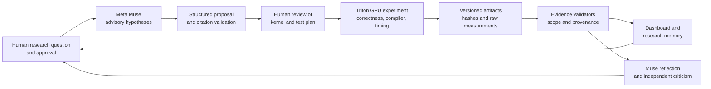

# National Tensor

**Contributors and AI coding assistants:** read the [project handoff](docs/PROJECT_CONTEXT.md) before resuming work.

**Can an AI research system generate hypotheses, test them against real GPU hardware, learn from negative results, and improve future research decisions?**

National Tensor is a Meta Global AI Developer Hackathon 2026 research project built around that question. It connects Meta Muse proposals to controlled Triton GPU experiments, preserves the evidence behind each result, and feeds validated observations into later advisory research steps. The current system supports hypothesis generation, human-reviewed experiments, reflection, criticism, and blinded study workflows. It does **not** run an end-to-end autonomous optimization loop: people still review proposed kernels and authorize GPU work.

A useful result here can be a negative one. When a proposed source change compiled to the same executable code, the project recorded that finding and skipped an uninformative timing claim. When a different scheduling idea reached timing, its screening data remained labeled unconfirmed. The goal is to make each research decision traceable to what was actually tested.

**Start with the [public research evidence bundle](public_evidence/README.md):** it includes a portable, hash-verified summary of Experiments 005–009 and can be checked with Python alone—no GPU, Muse key, or original local artifacts required. The verifier checks integrity and internal arithmetic; it does not reproduce GPU measurements.

## A Research Cycle in Practice

Muse proposed **Hilbert Tile Traversal** as a possible way to improve locality by changing GEMM tile order. A human-reviewed Triton implementation passed scoped correctness checks, then eight paired GPU screening comparisons produced no independently confirmed advantage. The follow-up Muse reflection chose **abandon** as an advisory decision using the recorded screening evidence and its missing confirmation and profiling status. The useful output of this cycle is a bounded negative result and a documented next research decision, not a claimed speedup. See the [public evidence summary](public_evidence/summary.md), [Experiment 005 protocol](docs/experiment_005.md), and [Experiment 006 reflection](docs/experiment_006.md).

## How the research loop fits together



The arrows represent implemented paths and explicit human handoffs, not automatic promotion from a model response to GPU execution. See the [research workflow](docs/research_workflow.md) and [dashboard guide](docs/dashboard.md) for the operational boundaries.

## What is implemented

- **Advisory Muse workflows:** structured hypothesis proposals, research planning, reflection on validated evidence, independent criticism, and proposed revisions. Requests are explicit; rejected responses and validation reasons are retained. See the [Wild Research Lab](docs/muse_wild_research_lab.md), [reflection](docs/experiment_006.md), and [critic](docs/experiment_008.md) guides.
- **Controlled GPU work:** correctness gates, compiler artifact comparisons, paired CUDA-event timing where justified, and separate screening and confirmation stages. Experiment 005 implements row-major, grouped-M4, and Hilbert tile assignment for a shared FP16 GEMM body. See [Experiment 004](docs/experiment_004.md) and [Experiment 005](docs/experiment_005.md).
- **Evidence handling:** source hashes, SHA-256 stage manifests, fixed evidence IDs and observation keys, and read-only validators that reject missing or inconsistent artifacts. The [dashboard](docs/dashboard.md) exposes saved evidence and distinguishes observations from model interpretation.
- **Study tools:** Experiment 007's matched proposal requests and manual blind scoring; Experiment 009's paired decision-request, criticism-binding, blind-review, scoring, and reveal workflow. These tools support studies; they do not make their incomplete evaluations conclusive. See [Experiments 007](docs/experiment_007.md) and [009](docs/experiment_009.md).

**Experimental or unfinished:** a repeatable latency advantage for Hilbert traversal has not been established; the independent confirmation stage is absent from the validated Experiment 005 record. Experiment 009 has a prepared six-proposal study and a P01 decision pair locally, but the other pairs and complete blinded scoring/reveal are still outstanding. Broader autonomous research-quality improvement is the question being tested, not an implemented or proven capability.

## Research timeline

| Experiment | Question and recorded status |
| --- | --- |
| **003** | Does a reviewed mask-hoisting variant change generated code for a 128 × 3072 × 768 FP16 GEMM? Correctness passed; the compared executable sections and relevant metadata matched, so timing was skipped. The original Muse-generated source was **not** executed. See the [debrief](docs/muse_research_debrief.md) and [diagnostic implementation](mask_hoisting_m128_experiment.py). |
| **004** | Does a partial M boundary tile expose a difference missed at M=128? The 128 and 130 workload diagnostics passed correctness; the unchanged reviewed source pair remained compiler-equivalent within each tested workload. No runtime comparison was run. [Details](docs/experiment_004.md). |
| **005** | Could Hilbert tile traversal improve GEMM scheduling? Mapping and correctness verification passed across four representative shapes. Eight paired screening comparisons against row-major and grouped-M4 were recorded; independent confirmation is missing. [Protocol and limits](docs/experiment_005.md). |
| **006** | Can Muse reflect on that result without treating screening as proof? An accepted, cited advisory reflection was recorded; it is model interpretation, not a new hardware measurement. [Details](docs/experiment_006.md). |
| **007** | Does access to the reflection change generated hypotheses? Six original proposals from two matched conditions were validated and manually scored blind. The scores are subjective and do not establish statistical superiority. [Details](docs/experiment_007.md). |
| **008** | Can an independent critic identify overlap, flaws, and research value in those proposals? The critic protocol, audit trail, and validation are implemented; P01 has an accepted criticism, while other local attempts include rejections. Criticism is advisory. [Details](docs/experiment_008.md). |
| **009** | Does giving a decision-maker criticism improve its choices? The rubric, paired request protocol, P01 binding, and P01 A/B decisions exist locally. The six-proposal paired evaluation and blind scoring remain incomplete. [Details](docs/experiment_009.md). |

## What the hardware evidence says

- **Experiments 003–004:** compiler and correctness diagnostics support equivalence of the *specific reviewed source pair* in the recorded configurations. They do not show a speedup, slowdown, universal compiler behavior, or performance of the original generated source. No runtime was measured for these diagnostics.
- **Experiment 005:** all three scheduling strategies passed the scoped FP16 reference checks on four shapes. The recorded screening median paired Hilbert-over-opponent ratios ranged from about **0.981× to 1.002×**; every reported bootstrap lower bound was at or below 1. Screening alone cannot establish an advantage, and the validation loader reports hypothesis support as **not established** because there is no independent confirmation. The persistent Hilbert lookup's one-time construction cost was measured separately from timed launches. Cache-locality causation has not been demonstrated.
- **Experiments 007–009:** proposal scores and decision-quality rubrics are human judgments. They can organize comparison and reveal disagreements, but six proposals and subjective scores do not prove that reflection or criticism improves research decisions. Experiment 009 has no complete paired score result or measured resource savings.

These statements are scoped to the local validated records described in the linked experiment guides. **The Experiment 003–009 original run artifacts are ignored by Git and are not included in a fresh GitHub clone.** The [public bundle](public_evidence/README.md) publishes an allowlisted, hash-verified view of the key Experiment 005–009 findings. A clone can inspect that export but cannot independently reproduce the GPU measurements without the preserved artifact directories or fresh, explicitly approved experiments. The local Experiment 005 verification run is `20261030T013245142673Z`; its screening stage is `20261030T013442437146Z`.

## Setup and reproducibility

Run commands from the repository root. The recorded GPU environment was **NVIDIA GeForce RTX 4060 Ti (16 GB), CUDA 12.8, PyTorch 2.11.0+cu128, Triton 3.6.0, Python 3.13.11, and Linux under WSL2**. Other hardware or software versions may compile or measure differently. The repository does not contain a complete pinned environment lockfile.

1. Create a Python environment and install the project tools. Install a PyTorch build compatible with your CUDA driver and Triton for GPU experiments; the example below installs the dashboard, API, and test dependencies into the new environment:

   ```bash
   python3.13 -m venv .venv
   .venv/bin/python -m pip install -r requirements-dashboard.txt openai python-dotenv pytest
   ```

   Install compatible `torch` and `triton` packages separately before using GPU or evidence-loading commands. Muse requests additionally require `MODEL_API_KEY` in the environment or a local `.env`; **none** of the commands below makes a model request. GPU experiments require explicit review and approval as described in their guides.

2. Check the CPU-side study logic and inspect the no-execution search plan:

   ```bash
   .venv/bin/python -m pytest -q tests/test_muse_critic_value_study.py tests/test_muse_research_critic.py tests/test_muse_discovery_study.py
   .venv/bin/python compare_search.py --dry-run
   ```

3. With the dependencies and available saved records, open the local dashboard:

   ```bash
   .venv/bin/python dashboard_app.py
   ```

   Visit `http://127.0.0.1:8501/`. The server binds to localhost. Which historical views are populated depends on which artifact directories are present; opening the dashboard does not rerun GPU experiments. See the [dashboard guide](docs/dashboard.md).

For a short **existing-record demonstration** in the original artifact-bearing workspace, validate the Experiment 009 setup and inspect one matched request without sending it:

```bash
.venv/bin/python muse_critic_value_study.py --validate --run-id 20261030T205425148094Z
.venv/bin/python muse_critic_value_study.py --decision-request --run-id 20261030T205425148094Z --proposal-id P01 --condition A
.venv/bin/python muse_critic_value_study.py --decision-request --run-id 20261030T205425148094Z --proposal-id P01 --condition B
```

These commands require the locally preserved Experiment 003–009 evidence chain; they will not work from a source-only clone. The B specification appends the independent critic assessment, while both specifications use the same original proposal, evidence, model, settings, schema, and core instructions. Follow [Experiment 009](docs/experiment_009.md) for the full manual study workflow. For a fresh clone, the CPU tests and `compare_search.py --dry-run` are the demonstration path that avoids both GPU benchmarking and Muse API requests.

## Stack and research boundaries

- **Model and interface:** Meta Muse (`muse-spark-1.3`) through a Responses-compatible API client; JSON schemas and deterministic response validators.
- **GPU and analysis:** Python, PyTorch, Triton, CUDA events, compiler IR/PTX/SASS inspection, and optional Nsight Compute profiling.
- **Presentation and records:** Flask dashboard, JSON/JSONL audits, SHA-256 manifests, and local experiment directories.

The tested GEMMs are representative FP16 workloads, not validated production-model workloads. Compiler identity, correctness checks, and timing answer different questions; a matching binary does not imply a universal optimization result, and a screening interval does not identify a hardware cause. The main open questions are whether any new hypothesis survives independent timing confirmation, whether profiling supports its proposed mechanism, and whether blinded paired evaluation shows better decisions when criticism is available. Human reviewers still decide what to implement, execute, prioritize, and accept.

## Attribution

National Tensor builds on **prior Matmul Inspector work** for compiler/PTX/SASS comparison and profiler evidence. The new hackathon research work in this repository connects Muse advisory proposals to evidence validation, human-gated Triton experiments, negative-result reflection, criticism, and controlled decision studies. Existing Matmul Inspector findings are treated as prior evidence where cited; they are not presented as newly discovered National Tensor speedups. See the [kernel evolution notes](docs/kernel_evolution.md) and [dashboard evidence guide](docs/dashboard.md) for where those comparisons enter the workflow.
